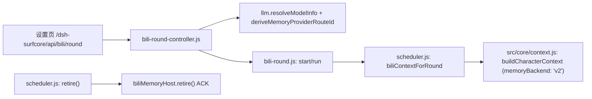

# Bili Memory V2：受控单轮所选模型正向接线与调度器退役 ACK

状态：已完成并验收通过。

## 1. 链路



## 2. 机制

1. **所选模型（selected-model）正向校验**：在 `bili-round-controller.js` 启动单轮前，除了检查 catalog 外，强制经 `deriveMemoryProviderRouteId({ provider, model })` 校验并派生路由，若底层 `llm.resolveModelInfo` 可用则校对模型元数据一致性，防范任意未解析模型进入单轮。
2. **V2 上下文安全构建**：`scheduler.js:biliContextForRound` 接入 V2 记忆模式分支。在 `v2` 模式下，直接调用 `buildCharacterContext({ memoryBackend: 'v2', includeMemory: Boolean(preparedMemory) })`，构造纯净的人格卡/对齐上下文，不再读取旧 V1 记忆文件（`persona.md`、`memory-card.json`、`life.md`、`purpose.json`）；未传入合法 V2 接线或未初始化控制库时严格保持 `BILI_V2_MANAGED_ROUND_REQUIRED` 阻断。
3. **退役 ACK 回传闭环**：`scheduler.js:retire()` 在调用 `biliV2Agent.retire()` 时捕获并向上传递返回的 ACK 对象（含 `{ ok: false, code: 'BILI_V2_RETIRE_UNCONFIRMED' }`），使上层 `index.js:resetBiliSchedulerSession`、`stopLegacy`、`switchCharacterImplementation` 能够准确感知并阻断未确认退役的后续操作。

## 3. 爆炸半径

- 仅影响 B站 受控单轮的启动检查、单轮上下文组装以及调度器退役状态回传。
- 不修改 `bili-round.js` 内部 2 次模型调用上限、媒体等待、评分和 partial 续评逻辑。
- 零外部网络调用，零实际 B站 发送。

## 4. 取舍

- **对比路线 B（全面纳管为 Host Trigger）**：若将单轮整体重构为 `bili-v2-host.mjs` 的 trigger kind，跨模块面极大，破坏现有的 round 控制器 API、partial 续评、UI 轮询和 2 次调用配额控制，回归面波及整个 B站 模块。
- **选择路线 A（轻量外围接线）**：改动集中在 `scheduler.js` 和 `bili-round-controller.js`，完全保留现有状态机与取消流，在保证模型路由安全和旧记忆隔离的前提下以最小代价达成正向单轮接线。

## 5. 生效与重启

桌面插件 Host 读取；完整门禁通过后安装。本次验证在隔离测试中完成，未重启真实桌面应用，生产默认仍为 V1。

## 6. 验证

- Node 24 运行 `plugins/surfcore/scripts/test-memory-v2-bili-round-fence.mjs`：选 V2 与显式 V2 阻断旧记忆读取（`legacyMemoryReads === 0`），提供合法 V2 选项时成功返回 V2 上下文，调度器退役 ACK 回传验证通过。
- Node 24 运行 `plugins/surfcore/scripts/test-bili-round-controller.mjs`：所选模型合法派生 `providerRouteId`，模型元数据解析失败时正确拒绝并返回 `BILI_ROUND_MODEL_UNAVAILABLE`。
- Node 24 运行 `plugins/surfcore/scripts/test-bili-round.mjs`：单轮状态机与评分有界回归通过。
- Node 24 运行 `plugins/surfcore/scripts/test-memory-v2-bili-lifecycle.mjs`：换号、扫码与凭据变更退役屏障通过。

## 7. 回滚与残余

若需回滚，仅需回退 `plugins/surfcore/lib/scheduler.js`、`plugins/surfcore/lib/bili-round-controller.js`、`plugins/surfcore/lib/bili-round.js` 和 `plugins/surfcore/lib/index.js` 中关于单轮 V2 上下文与退役 ACK 的几处提交；旧 V1 路径保持完全不变。

## 发布交接块

```yaml
- 范围: Bili 受控单轮所选模型正向 V2 接线、模型路由校验与调度器退役 ACK 回传
- 文件:
  - plugins/surfcore/lib/scheduler.js
  - plugins/surfcore/lib/bili-round-controller.js
  - plugins/surfcore/lib/bili-round.js
  - plugins/surfcore/lib/index.js
  - src/core/context.js
  - plugins/surfcore/scripts/test-memory-v2-bili-round-fence.mjs
  - plugins/surfcore/scripts/test-bili-round-controller.mjs
  - docs/cases/2026-11-11-memory-v2-bili-manual-round.md
- 验证:
  - test-memory-v2-bili-round-fence.mjs PASS (V2 隔离与正向接线、retire ACK)
  - test-bili-round-controller.mjs PASS (模型路由派生与非法拒绝)
  - test-bili-round.mjs PASS (单轮完整流程)
  - test-memory-v2-bili-lifecycle.mjs PASS (凭据退役屏障)
- 状态: 验收通过，待用户确认提交。保持 V1 默认。
```
