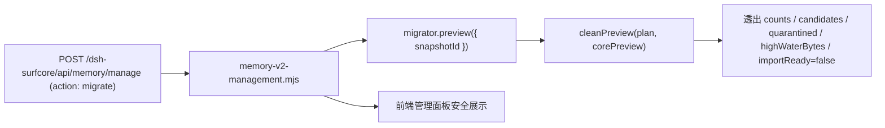

# Memory V2：迁移盘点安全预览暴露与隔离区完整性

状态：已完成并验收通过。

## 1. 链路



## 2. 机制

1. **安全预览指标透出**：在 `memory-v2-management.mjs:cleanPreview` 中扩充对迁移盘点（`migrate`）结果的格式化。安全抽取并透出 `counts`（包含 `sources`、`records`、`candidates`、`quarantined`、`invalidRows`、`partialTails`、`protectedRecords`、`parts`）、`candidates`、`quarantined`、`conflicts`、`highWaterBytes`、`phase: 'plan-only'` 和 `importReady: false`。
2. **脱敏与信息隐匿**：绝不回显绝对文件路径、原始聊天文本、凭据或未脱敏原文。前端仅能获取结构化的统计指标与状态，满足“可见迁移预览”的验收要求。
3. **隔离区与未授权阻断**：严格维持 `manifest.importReady = false` 与 `capabilities.activation = false`。盘点过程中凡缺乏权威证据证明历史登录账号与 ACL 的旧记录，强制归入 `MIGRATION_AUTHORITY_UNKNOWN` 隔离区；坏行与截断尾部安全截断在 `safeImportEnd` 之前，不推进持久游标。

## 3. 爆炸半径

- 仅扩充 `plugins/surfcore/lib/memory-v2-management.mjs` 中 `cleanPreview` 返回给前端的字段集。
- 零底层存储修改，零实际数据库导入或写入，零删除。

## 4. 取舍

- **对比直接导入**：若跳过盘点直接批量导入，可能在历史文件迁移或格式冲突时产生脏数据或虚假的送达证明。
- **只读盘点与可见预览方案**：通过独立 `planLegacyMigration` 和 `cleanPreview` 透出明确的盘点指标，供用户在界面上明确核对候选数与隔离数，获得显式确认前决不触碰实际生产数据。

## 5. 生效与重启

桌面插件 Host 读取；完整门禁通过后安装。生产保持 V1 默认。

## 6. 验证

- Node 24 运行 `scripts/test-memory-v2-migration-plan.mjs`：22 项检查通过，39 类合成来源原件 SHA256 未变。
- Node 24 运行 `scripts/test-memory-v2-legacy-registry.mjs`：独立 SQLite 逻辑流登记、事务排他与防篡改验证通过。
- Node 24 运行 `plugins/surfcore/scripts/test-memory-v2-management.mjs`：新增 `migration-preview-exposes-safe-counts-and-quarantine-while-keeping-activation-false` 用例，36 项检查全绿。

## 7. 回滚与残余

若需回滚，仅需撤销 `memory-v2-management.mjs` 中 `cleanPreview` 的新增字段映射，其余核心存储与规划器完全不受影响。

## 发布交接块

```yaml
- 范围: Memory V2 迁移盘点安全预览指标暴露、隔离区完整性与激活阻断
- 文件:
  - plugins/surfcore/lib/memory-v2-management.mjs
  - plugins/surfcore/scripts/test-memory-v2-management.mjs
  - docs/cases/2026-11-11-memory-v2-migration-preview.md
- 验证:
  - test-memory-v2-migration-plan.mjs PASS (22 checks, 39 sources unchanged)
  - test-memory-v2-legacy-registry.mjs PASS (isolated sqlite registry)
  - test-memory-v2-management.mjs PASS (36 checks, safe preview fields verified)
- 状态: 验收通过，待用户确认提交。保持 V1 默认，激活保持 false。
```
